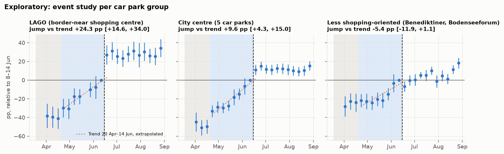
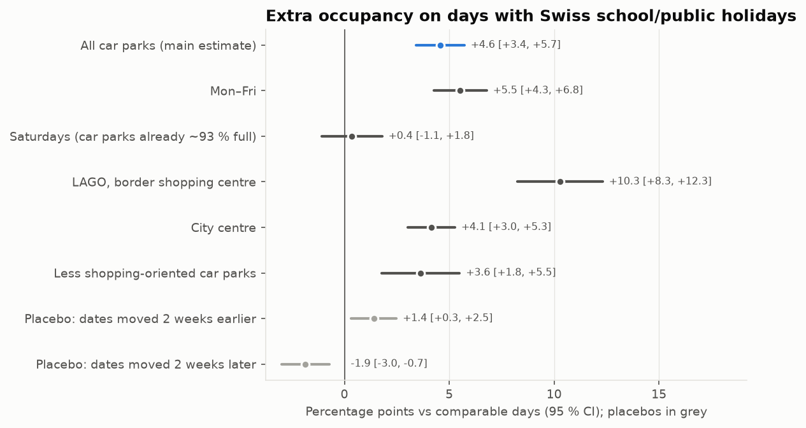

# What drives parking occupancy in Konstanz?

Konstanz sits right on the Swiss border, and Swiss shoppers are a familiar sight in its city
centre. This project asks how much **Swiss shopping tourism** actually shows up in the city's car
parks, beyond weather and day of week. It combines seven years of 5-minute occupancy data for
nine car parks (2015–2022) with weather, Swiss and German holidays and the CHF/EUR exchange rate.
It then tests the question three ways: the 2020 border closure as a natural experiment, Swiss
holidays on German shopping days, and the exchange rate. The analysis was **pre-specified before
any model was run**, and every robustness check is reported, including the ones that weakened the
results. A small collector on GitHub Actions keeps recording live occupancy every 15 minutes.

## Key findings

1. **Swiss school holidays bring noticeably more cars to Konstanz.** On German shopping days when
   Thurgau or Zürich has school holidays, daytime occupancy is about **5 percentage points (7 %)
   higher** than on comparable days (≈ 140 extra cars on average during the day). At the LAGO
   shopping centre by the border it is about 10 points, and the effect is larger when both cantons
   are on holiday.
   *Caveats:* placebo checks suggest up to about 2 points could be seasonal timing. On Saturdays
   the car parks are already ~93 % full, so any extra demand there cannot be seen in the data.
2. **When the border reopened on 15 June 2020, occupancy at LAGO jumped** by about 23–25 points
   (≈ 210–230 cars) beyond its recovery trend within a week, and the jump holds whatever shape the
   trend is given.
   *Caveats:* this is an exploratory result for one car park and one event. In the city centre the
   same date looks just like the end of the post-lockdown recovery, and the data cannot separate
   the two. The simple before/after comparison (+28 points) mostly measures that recovery.
3. **The exchange rate shows no measurable link with occupancy** once season and trends are
   accounted for.
   *Caveats:* this is a correlation, not a causal test. The franc only moved about 13 % in the
   sample, so large effects are ruled out but small ones cannot be detected.



*2020 occupancy relative to the same weeks of 2016–2019, by car park group. Shaded: lockdown (grey)
and "shops open, border closed for shopping" (blue). Dashed line: border reopening on 15 June.*



## Reports

- **[Analysis report](reports/analysis.md):** methods, all estimates with 95 % confidence
  intervals, robustness checks, confounders and limitations. The
  [pre-specified plan](reports/analysis_plan.md) was committed before any model ran.
- **[Data quality report](reports/data_quality_parkendd.md):** how the 2015–2022 history was
  cleaned. It covers gaps, frozen sensors, daily feed resets, impossible values, the DST and
  timezone check, and why occupancy uses an *effective* capacity instead of the official one.
- **[Auxiliary data notes](reports/auxiliary_data.md):** how weather, CHF/EUR, holidays and the
  2020 COVID-19 phases are joined, with sources for every date.

Everything in `reports/` is regenerated from the data with one command per report (see
[Development](#development)).

## How the live collector works

The historical dumps end in 2022, so a collector records the current state of every car park:

- `.github/workflows/collect.yml` polls four sources every 15 minutes: the city's parking guidance
  web page (the only source with working live counts for the city centre), the city's ArcGIS open
  data service, and MobiData BW's ParkAPI for both the city and the four University of Konstanz car
  parks. The university car parks have nothing to do with shopping, which makes them a useful
  comparison series.
- Each response is appended **unchanged** to `data/raw/<source>/<YYYY-MM-DD>.jsonl` on the
  **`data` branch**, so `main` stays clean. Each line holds the request metadata (timestamps,
  HTTP status, all retry attempts, SHA-256 of the full body) and the body itself. Raw files are
  never modified. All cleaning writes new files.
- For the city web page only the parking section (a verbatim ~12 KB slice of the ~260 KB
  page) is stored. If the page layout changes and the section cannot be found, the full page
  is stored instead.
- Bad responses (timeouts, HTTP errors, malformed bodies, city outages) never fail the
  workflow. They are recorded as data and shown as warning annotations.
- GitHub's cron is best-effort and drops many runs on quiet repositories. An external scheduler
  ([cron-job.org](https://cron-job.org)) therefore triggers the workflow every 15 minutes through
  the `workflow_dispatch` API, with GitHub's own schedule as a backup. A run within 10 minutes of
  the previous snapshot is skipped and logged, so the two triggers never create duplicates. Every
  run logs its real start and end time to `data/raw/runs/<date>.jsonl`.
- Requests identify themselves with a descriptive User-Agent including a contact address.
  `konstanz.de` gets at most one request per run, and retries wait at least 30 s, as its
  robots.txt asks.

## Data sources & licensing

Some of the data used here is openly licensed and some is not. Each source keeps its own terms.

| Source | Used for | License / terms | Attribution & notes |
|---|---|---|---|
| [Stadt Konstanz – ArcGIS "Parkplätze Live"](https://offenedaten-konstanz.de/dataset/parkplaetze-und-parkleitsystem) (via MobiData BW) | Capacities, coordinates, metadata; live fields when they work | **CC BY 4.0** | **© Stadt Konstanz, CC BY 4.0** (Amt für Liegenschaften und Geoinformation). As of Nov 2026 the live fields are empty for 9 of 11 sites. |
| [MobiData BW ParkAPI v3](https://api.mobidata-bw.de/park-api/) – source `konstanz` | Same city data via the state platform | **CC BY 4.0** | **© Stadt Konstanz, CC BY 4.0**. Shows the same gaps as ArcGIS. |
| MobiData BW ParkAPI v3 – source `pbw` | University car parks (comparison series) | **Not stated** by the platform for this source | Operator: Parkraumgesellschaft Baden-Württemberg. |
| [Stadt Konstanz – Parkleitsystem web page](https://www.konstanz.de/leben+in+konstanz/mobilitaet/parkleitsystem) | **Primary** live free-space counts for the city-centre car parks | **No license stated** | Collected in line with the site's robots.txt: at most **1 request per 15 minutes**, retries wait ≥ 30 s (crawl-delay), and every request sends a descriptive User-Agent with a contact address. Raw snapshots are kept for this research project only. Please do not reuse them. |
| [ParkenDD dumps](https://parkendd.de/dumps/) | Historical 5-min data, 2015–2022 | **No license stated** | Downloaded locally by `konstanz-parking download-parkendd` into a gitignored folder. **Never committed or redistributed**; only aggregate statistics and figures appear in `reports/`. |
| [DWD Open Data](https://opendata.dwd.de/) – station 02712 Konstanz | Weather | **CC BY 4.0** ([DWD terms of use](https://opendata.dwd.de/climate_environment/CDC/Terms_of_use.pdf)) | **Source: Deutscher Wetterdienst (DWD), CC BY 4.0.** |
| [ECB data API](https://data.ecb.europa.eu/) – `EXR/D.CHF.EUR.SP00.A` | CHF/EUR exchange rate | [ECB statistics reuse policy](https://www.ecb.europa.eu/stats/ecb_statistics/governance_and_quality_framework/html/usage_policy.en.html): free reuse, the source must be quoted and the statistics not altered | **Source: ECB statistics.** |
| [OpenHolidays API](https://www.openholidaysapi.org/) | School holidays for DE-BW, and for CH-TG/CH-ZH from 2020 | **ODbL 1.0** ([data repository](https://github.com/openpotato/openholidaysapi.data)) | **Contains data from the OpenHolidays API, ODbL 1.0.** Some Swiss school holidays are set per municipality, so canton-level dates are approximate. |
| [EDK school holiday lists](https://www.edk.ch/de/bildungssystem/kantonale-schulorganisation/Schulferien) (via edudoc.ch / Internet Archive) | Swiss school holidays 2015–2019, transcribed with sources into `auxiliary/ch_school_holidays_manual.csv` | Reproduction with source attribution ("Nachdruck nur mit Quellenangabe gestattet") | **Source: EDK / IDES, Schulferien 2015–2020.** |
| [`holidays`](https://pypi.org/project/holidays/) Python package | Public holidays DE-BW, CH-TG, CH-ZH | MIT | |

**Takedown:** If you own any of this data and want it removed, please contact me at
irem11314@gmail.com.

The **code** in this repository is licensed under the [MIT License](LICENSE). The MIT License
covers the code only, **not** the data: each data source keeps its own terms listed above.

## Development

Requires Python 3.12 and [uv](https://docs.astral.sh/uv/).

```bash
uv sync
uv run pytest
uv run ruff check . && uv run ruff format .

uv run konstanz-parking collect --data-dir /tmp/raw     # poll once
uv run konstanz-parking download-parkendd               # history → data/external/parkendd/

# Pipeline for the ParkenDD history (outputs in data/processed/ are not committed)
uv run konstanz-parking coverage     # raw coverage per car park and month → reports/tables, reports/figures
uv run konstanz-parking clean        # flags → data/processed/parkendd_clean.parquet + parkendd_15min.parquet
uv run konstanz-parking report       # → reports/data_quality_parkendd.md
uv run konstanz-parking fetch-aux    # DWD, ECB, OpenHolidays → data/external/
uv run konstanz-parking features     # → data/processed/features_15min.parquet
uv run konstanz-parking analysis     # → reports/analysis.md (+ figures, tables)
```

The collector workflow runs with `uv run --no-default-groups`, so it only installs `httpx`. The
analysis libraries (pandas, DuckDB, matplotlib, …) live in the `analysis` dependency group.
