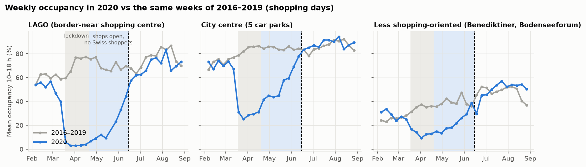
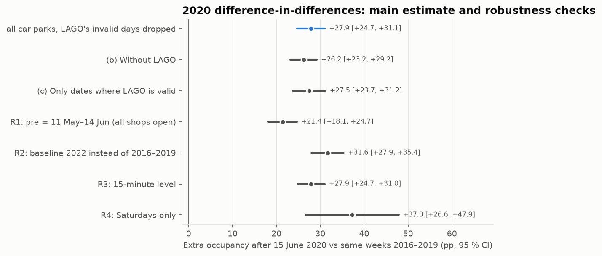
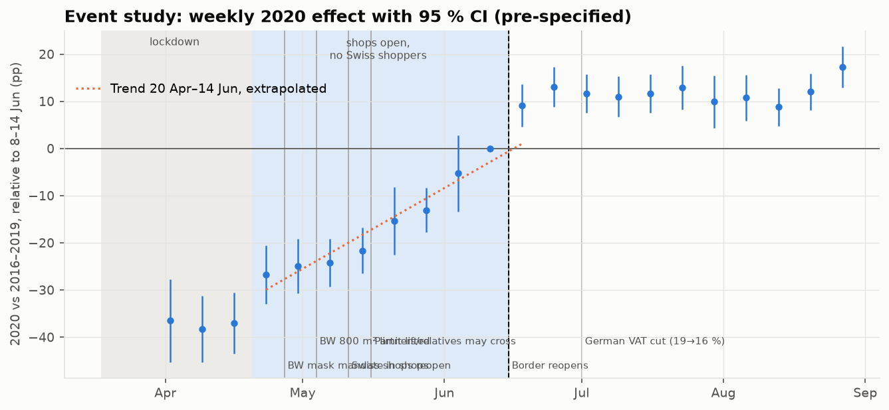
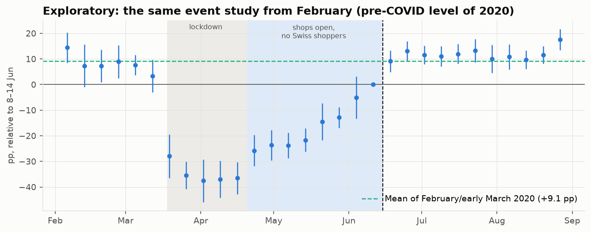
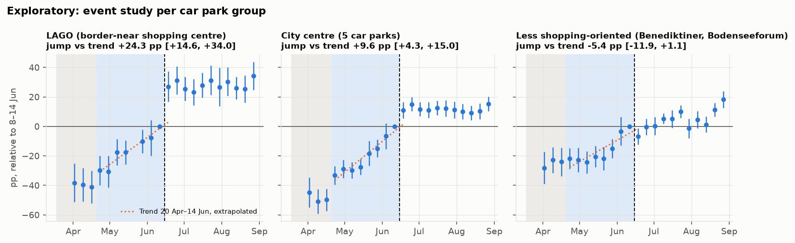
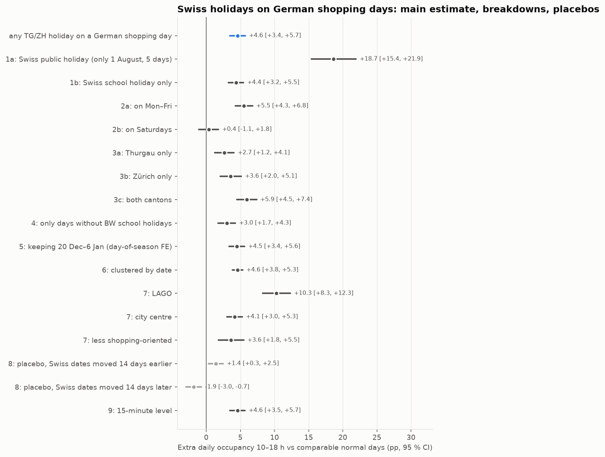
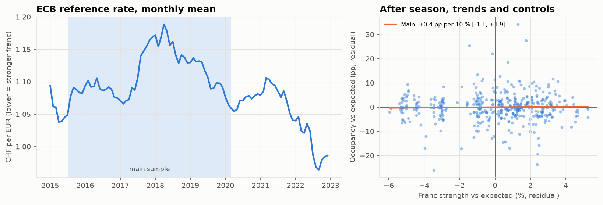
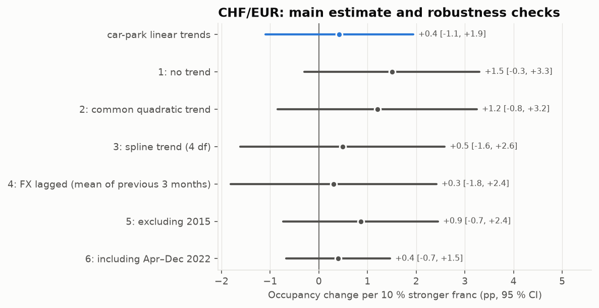

# Does Swiss shopping tourism drive parking occupancy in Konstanz?

Generated by `uv run konstanz-parking analysis` from the cleaned ParkenDD history (2015–2022, nine
car parks) joined with weather, holidays and CHF/EUR. The analysis was **pre-specified** in
[`analysis_plan.md`](analysis_plan.md), committed before any model was run. Every robustness check
from the plan is reported below, whatever its result.

**Outcome:** daily mean occupancy (10:00–18:00 local) of one car park, in percentage points of its
effective capacity, on German shopping days (Mon–Sat, not a BW public holiday). Car-park-days need
≥ 24 of 32 valid 15-minute bins. All effects come with 95 % confidence intervals. "≈ cars" converts
percentage points into cars parked at an average daytime moment, using the summed effective
capacity of the car parks in the sample.

## Summary

| Angle | Estimate [95 % CI] | What it means |
|---|---|---|
| 1. 2020 border closure (DiD) | +27.9 [+24.7, +31.1] pp | **Upper bound.** Mostly the post-lockdown recovery, not a Swiss effect. |
| 1. Event study: step at reopening, all car parks | +8.1 [+3.3, +12.9] pp | Not robust: about 0 with a more flexible trend. |
| 1. Event study: step at reopening, LAGO (exploratory) | +23 to +25 pp across trend shapes | Robust step at the border-near shopping centre, ≈ 214–234 cars. |
| 2. Swiss holiday on a German shopping day | +4.6 [+3.4, +5.7] pp (+7 %) | Robust across checks, but placebos reach ±1.9 pp. Not measurable on Saturdays (car parks full). |
| 3. CHF/EUR, per 10 % stronger franc | +0.4 [-1.1, +1.9] pp | No detectable association (correlational). |

## 1. The 2020 natural experiment

**Design (pre-specified).** Difference-in-differences on daily occupancy (10–18 h, shopping days).
The model compares `pre` = 20 Apr–14 Jun 2020 (BW shops open, crossing to shop banned) with `post` =
15 Jun–9 Aug 2020 (border open). It subtracts the change between the same calendar dates in
2016–2019. Fixed effects: car park × year, car park × period, car park × weekday. Controls: weather
(temperature and its square, rain, sunshine), BW school holidays, bridge days. Standard errors are
clustered by date. Car parks: altstadt, augustiner, benediktiner, bodenseeforum, doebele, fischmarkt, lago, marktstaette, seerheincenter. Seerheincenter has a 2016–2017 baseline, so it is included
(see *Deviations*).
2020 has 44 shopping days in `pre` and 48 in `post`.
Mean 2020 occupancy in `pre` was 40 %.

The raw picture already shows the problem with this design. In 2020 occupancy did not stay flat
during `pre`. It climbed steadily from the lockdown low back towards normal, and in the city centre
it reached the normal level at about the time the border reopened.

### Main estimate and robustness checks

| Specification | Effect (pp) [95 % CI] | p | ≈ cars | Car parks | 2020 days | Obs. |
|---|---|---|---|---|---|---|
| **Main: all car parks, LAGO's invalid days dropped** | +27.9 [+24.7, +31.1] | < 0.001 | ≈ +871 | 9 | 92 | 3,351 |
| (b) Without LAGO | +26.2 [+23.2, +29.2] | < 0.001 | ≈ +573 | 8 | 92 | 2,961 |
| (c) Only dates where LAGO is valid | +27.5 [+23.7, +31.2] | < 0.001 | ≈ +858 | 9 | 81 | 3,265 |
| R1: pre = 11 May–14 Jun (all shops open) | +21.4 [+18.1, +24.7] | < 0.001 | ≈ +668 | 9 | 75 | 2,776 |
| R2: baseline 2022 instead of 2016–2019 | +31.6 [+27.9, +35.4] | < 0.001 | ≈ +975 | 9 | 92 | 1,586 |
| R3: 15-minute level | +27.9 [+24.7, +31.0] | < 0.001 | ≈ +871 | 9 | 92 | 107,063 |
| R4: Saturdays only | +37.3 [+26.6, +47.9] | < 0.001 | ≈ +1164 | 9 | 16 | 574 |

- **Main estimate (pre-specified):** occupancy rose **27.9 pp** more from `pre` to
  `post` in 2020 than in a normal year (95 % CI 24.7 to 31.1).
- **LAGO gap:** the three LAGO versions give **26.2 to 27.9 pp**. Dropping
  LAGO, or keeping only dates on which LAGO is valid, moves the estimate by less than 2 pp. LAGO's
  14 frozen days do not drive the result.
- **This is not a clean Swiss effect.** The main estimate is reported as pre-specified, but it
  compares the *average* of `pre` (which includes the deep post-lockdown dip of late April) with
  the average of `post`. Most of it is the general recovery. Starting `pre` on 11 May (R1) lowers it
  to 21.4 pp. **Read the DiD as an upper bound, not as an estimate of the
  Swiss effect.** The event study tries to separate the two.

### Event study (pre-specified)

Each point is the 2020 deviation from the same week of 2016–2019, relative to the last week before
the reopening (8–14 Jun). Pre-specified reading: compare the step into the week of 15 June with
the linear trend of the weeks 20 Apr–14 Jun, extrapolated one week.

- Through May and early June 2020, occupancy recovered by about
  **3.9 pp per week** relative to normal years.
- In the week of 15 June, occupancy was 9.1 pp above the reference week. The linear
  trend predicts 1.0 pp. **Pre-specified jump beyond the trend:
  +8.1 [+3.3, +12.9] pp** (p 0.001).
- After that the series is flat (weeks 0–7: +11.3 [+7.5, +15.0] pp), at about the level of February
  2020 relative to normal years (+9.1 pp, exploratory figure below). In other words,
  2020 was back to its pre-COVID level from the week of the reopening on.

**Sharp jump or gradual recovery? For the pooled data, the honest answer is: the data cannot
tell.** The recovery was accelerating in late May and early June, and a straight line through
all eight weeks underestimates its last steps. The jump is therefore sensitive to the shape of
the trend. This check was added after seeing the raw series (see *Deviations*):

| Group | Jump, linear trend 8 weeks (pre-specified) | Linear trend, last 4 weeks | Quadratic trend, 8 weeks |
|---|---|---|---|
| Pooled (all car parks) | +8.1 [+3.3, +12.9] | +4.1 [-2.5, +10.7] | +1.0 [-5.7, +7.8] |
| LAGO | +24.3 [+14.6, +34.0] | +22.9 [+9.9, +35.8] | +25.0 [+12.5, +37.6] |
| City centre | +9.6 [+4.3, +15.0] | +5.2 [-2.4, +12.8] | +1.1 [-6.5, +8.8] |
| Less shopping-oriented | -5.4 [-11.9, +1.1] | -16.0 [-24.4, -7.7] | -18.9 [-27.6, -10.1] |

Pooled and for the city centre, the jump shrinks to about zero with a more flexible trend. The
pattern fits a recovery that **completed** around mid-June about as well as it fits a Swiss
step. The plateau after 15 June does not settle the question either, because a completed recovery
also levels off at the normal level.

### Border-near vs city-centre car parks

Pre-specified DiD by group (one model, group-specific `2020 × post` terms):

| Group | Effect (pp) [95 % CI] | ≈ cars | Car parks |
|---|---|---|---|
| LAGO | +42.2 [+36.4, +47.9] | ≈ +395 | lago |
| City centre | +32.4 [+28.8, +36.0] | ≈ +412 | altstadt, augustiner, doebele, fischmarkt, marktstaette |
| Less shopping-oriented | +18.9 [+14.7, +23.2] | ≈ +121 | benediktiner, bodenseeforum |
| LAGO − less shopping | +23.2 [+18.4, +28.1] | | |
| Centre − less shopping | +13.5 [+9.8, +17.1] | | |

These group DiDs contain the same recovery bias as the pooled one. The more informative evidence is
the event study per group (exploratory, not pre-specified):

- **LAGO, right next to the Kreuzlingen border, shows a step at 15 June that survives every trend
  shape: +23 to +25 pp** (table above). That is roughly
  214–234 more cars of its ~936
  effective spaces at an average daytime moment. In the raw data, LAGO's gap to normal years
  halved within the first week after the reopening and closed in the second.
- **City centre:** a jump of +9.6 pp with the pre-specified trend, but
  +1.1 pp with a quadratic one. Not distinguishable from a
  completed recovery.
- **Less shopping-oriented** (Benediktiner, Bodenseeforum): no positive step under any trend. The
  negative values reflect an unusually high reference week (in the raw data 2020 was *above* normal
  in 8–14 Jun, but well below in the weeks before and after). Bodenseeforum is also not a
  clean control, because large events stayed banned all summer.

So the evidence ranks as the shopping-tourism hypothesis predicts, with a clear step only where Swiss
shoppers are expected to matter most. It is still **one car park and one event**. A LAGO-specific
change on 15 June (for example a rule for shopping centres) would produce the same picture. I found
none, but cannot rule it out.

### Confounders

| Confounder | Date | Handled? |
|---|---|---|
| Post-lockdown recovery trend | from 20 Apr 2020 | **Not by the DiD**, which it inflates. **Only partly by the event study:** the step at LAGO is robust to the trend's shape, the pooled and city-centre steps are not. The group comparison helps only if the recovery is similar across groups, which is not guaranteed. |
| German VAT cut 19 → 16 % | 1 Jul 2020 | **Yes for the step:** it starts two weeks after the reopening, and the weeks around 1 July show no further step. The DiD's `post` window includes it. Swiss shoppers can reclaim German VAT anyway, so the cut mainly affects German residents. |
| BW mask mandate in shops | from 27 Apr 2020 | **Largely:** in force during almost all of `pre` and all of `post`, so it cannot create a step on 15 June. It may lower 2020 levels overall. |
| Swiss summer holidays | TG from 4 Jul, ZH from 11 Jul 2020 | **On average yes:** baseline years have them at similar dates, and the step (15–21 Jun) comes before them. **Not handled:** in 2020 many Swiss holidayed at home instead of abroad, which could raise July shopping trips. No extra rise is visible in July. |
| Other steps inside `pre` | 800 m² limit lifted 4 May; Swiss shops reopen 11 May; partners may cross 16 May | Part of the recovery trend; robustness check R1 starts `pre` on 11 May. |
| Domestic tourism and events | BW hotels reopened in late May; large events stayed banned | **Not handled.** Tourism mainly builds up in July, after the step. The event ban keeps Bodenseeforum (comparison group) low. |
| Holidays inside the windows | Ascension, Pentecost, Corpus Christi; BW Pentecost holidays 2–13 Jun | Public holidays are not shopping days (excluded); bridge days and BW school holidays are controlled. The reference week 8–14 Jun contains Corpus Christi and its bridge day, so it is a slightly unusual reference (the jump test uses all eight weeks, which limits the impact). |

## 2. Swiss holidays on German shopping days (2015–2022)

**Design (pre-specified).** On German shopping days (Mon–Sat, not a BW public holiday), compare
occupancy on days when Thurgau or Zürich has a public or school holiday with other days **of the
same car park in the same month and year**. Fixed effects: car park × year-month, car park ×
weekday. Controls: weather, BW school holidays, bridge days. Standard errors are clustered by
calendar week, because school holidays come in blocks of consecutive days.

- Sample: 1,380 shopping days (Jul 2015–15 Mar 2020 and Apr–Dec 2022), 11,111
  car-park-days, 436 of these dates with a Swiss holiday, spread over
  97 calendar weeks.
- 20 Dec–6 Jan is excluded (Swiss Christmas holidays coincide with the German pre-Christmas peak).
  This also removes Berchtoldstag (2 January). The only Swiss-only public holiday left is **Swiss
  National Day (1 August)**, on 5 dates.
- 39 dates are dropped because the Zürich sport week is unknown.

| Specification | Effect (pp) [95 % CI] | p | % of normal-day mean | ≈ cars | Obs. |
|---|---|---|---|---|---|
| **Main: any TG/ZH holiday on a German shopping day** | +4.6 [+3.4, +5.7] | < 0.001 | +7.0 % | ≈ +143 | 11,111 |
| 1a: Swiss public holiday (only 1 August, 5 days) | +18.7 [+15.4, +21.9] | < 0.001 | +28.3 % | ≈ +583 | 11,111 |
| 1b: Swiss school holiday only | +4.4 [+3.2, +5.5] | < 0.001 | +6.6 % | ≈ +136 | 11,111 |
| 2a: on Mon–Fri | +5.5 [+4.3, +6.8] | < 0.001 | +8.4 % | ≈ +173 | 11,111 |
| 2b: on Saturdays | +0.4 [-1.1, +1.8] | 0.620 | +0.5 % | ≈ +11 | 11,111 |
| 3a: Thurgau only | +2.7 [+1.2, +4.1] | < 0.001 | +4.0 % | ≈ +83 | 11,022 |
| 3b: Zürich only | +3.6 [+2.0, +5.1] | < 0.001 | +5.4 % | ≈ +112 | 11,022 |
| 3c: both cantons | +5.9 [+4.5, +7.4] | < 0.001 | +9.0 % | ≈ +185 | 11,022 |
| 4: only days without BW school holidays | +3.0 [+1.7, +4.3] | < 0.001 | +4.6 % | ≈ +94 | 8,516 |
| 5: keeping 20 Dec–6 Jan (day-of-season FE) | +4.5 [+3.4, +5.6] | < 0.001 | +6.8 % | ≈ +140 | 11,670 |
| 6: clustered by date | +4.6 [+3.8, +5.3] | < 0.001 | +7.0 % | ≈ +143 | 11,111 |
| 7: LAGO | +10.3 [+8.3, +12.3] | < 0.001 | +16.1 % | ≈ +96 | 11,111 |
| 7: city centre | +4.1 [+3.0, +5.3] | < 0.001 | +5.1 % | ≈ +53 | 11,111 |
| 7: less shopping-oriented | +3.6 [+1.8, +5.5] | < 0.001 | +9.6 % | ≈ +23 | 11,111 |
| 8: placebo, Swiss dates moved 14 days earlier | +1.4 [+0.3, +2.5] | 0.011 | +2.1 % | ≈ +44 | 7,651 |
| 8: placebo, Swiss dates moved 14 days later | -1.9 [-3.0, -0.7] | 0.001 | -2.8 % | ≈ -58 | 7,651 |
| 9: 15-minute level | +4.6 [+3.5, +5.7] | < 0.001 | +6.9 % | ≈ +143 | 354,987 |

**Main estimate:** on a German shopping day with a Swiss holiday, average daytime occupancy is
**4.6 pp higher** (95 % CI 3.4 to 5.7) than on comparable
days. That is 7 % above the normal-day mean of 66 %,
or ≈ +143 cars across the 3125 effective spaces of these car parks.

What the breakdowns show:

- **School holidays** carry almost all events (+4.4 pp). **Swiss National Day**
  shows a much larger effect (+18.7 pp) but rests on only 5 days.
  All of them fall inside the Swiss summer holidays, so they are not independent events. Treat it
  as anecdotal.
- **Weekdays vs Saturdays:** +5.5 pp on Mon–Fri, +0.4 pp on Saturdays
  (+0.4 [-1.1, +1.8]). This is **not** evidence that Swiss shoppers stay away on Saturdays. On a normal
  Saturday the city-centre car parks and LAGO are already about 93 % full on average (10–18 h), and
  more than half of all Saturday quarter-hours are at ≥ 95 %. Extra demand cannot show up in
  occupancy when the car parks are full: it turns into queues or parking elsewhere. **Occupancy
  data cannot measure the Saturday effect.**
- **Both cantons on holiday** (+5.9 pp) > Zürich only (+3.6) >
  Thurgau only (+2.7). This dose-response pattern fits the hypothesis: more Swiss
  people off school, more extra cars.
- **By car park:** LAGO +10.3 [+8.3, +12.3] pp (+16 % of its normal level), city
  centre +4.1 [+3.0, +5.3], less shopping-oriented +3.6 [+1.8, +5.5]. The ordering again points to the
  border-near shopping centre, but the less shopping-oriented car parks also rise. Part of the
  effect is therefore not shopping specific (e.g. Swiss day trips and tourism in general).
- **Overlap with BW school holidays:** on days without BW school holidays the effect is
  +3.0 [+1.7, +4.3] pp. That is smaller than the main estimate, so the BW school holiday control may
  not fully separate the two when both fall in the same weeks.

**Placebo test: not passed cleanly.** Moving the Swiss dates by two weeks should give zero. It gives
+1.4 pp (+1.4 [+0.3, +2.5]) and -1.9 pp (-1.9 [-3.0, -0.7]).
School holidays fall at about the same time every year (e.g. July/August, October), and the
month fixed effects do not absorb all patterns *within* a month. A shifted indicator picks up
some of that seasonal timing. The placebo estimates are about a third of the main estimate and have
opposite signs. A reasonable reading is that **roughly ±2 pp of the main estimate could be seasonal
timing rather than Swiss holidays**. The effect stays positive under that margin but is less precise
than the confidence interval suggests.

## 3. CHF/EUR and occupancy (correlational)

**Design (pre-specified).** Monthly panel per car park, 52 months between Jul 2015 and
Feb 2020 (423 car-park-months with ≥ 10 valid shopping days). Occupancy is
regressed on log(EUR per CHF) with car park and calendar-month fixed effects, a linear trend per
car park, weather, and the share of BW school holiday and Swiss holiday shopping days in the month.
Standard errors are Driscoll–Kraay (robust to correlation across car parks and over
6 months).

**This angle is correlational.** The exchange rate is not assigned at random. It moves slowly,
together with the Swiss and German economies, retail trends (e.g. online shopping) and parking
supply. Nothing below is a causal estimate.

| Specification | pp per 10 % stronger franc [95 % CI] | p | ≈ cars | Months | Obs. |
|---|---|---|---|---|---|
| **Main: car-park linear trends** | +0.4 [-1.1, +1.9] | 0.587 | ≈ +13 | 52 | 423 |
| 1: no trend | +1.5 [-0.3, +3.3] | 0.102 | ≈ +47 | 52 | 423 |
| 2: common quadratic trend | +1.2 [-0.8, +3.2] | 0.249 | ≈ +38 | 52 | 423 |
| 3: spline trend (4 df) | +0.5 [-1.6, +2.6] | 0.649 | ≈ +15 | 52 | 423 |
| 4: FX lagged (mean of previous 3 months) | +0.3 [-1.8, +2.4] | 0.780 | ≈ +9 | 52 | 423 |
| 5: excluding 2015 | +0.9 [-0.7, +2.4] | 0.289 | ≈ +27 | 46 | 385 |
| 6: including Apr–Dec 2022 | +0.4 [-0.7, +1.5] | 0.466 | ≈ +12 | 61 | 504 |

- **Main estimate:** +0.4 [-1.1, +1.9] pp per 10 % stronger franc (p 0.587). **No detectable
  association.**
- Every robustness check also has a confidence interval that includes zero. Taken together, they
  run from -1.8 to +3.3 pp. The point estimates are all positive (the
  direction the hypothesis predicts) but small.
- **What this can and cannot say.** In the main sample the franc only moved between
  1.049 (2015-07) and 1.189 CHF per EUR (2018-04),
  a range of about 13 %. The big franc shock of January 2015 is before the data starts.
  About 77 % of the within-car-park FX variation is left after season,
  trends and controls, so the model has some variation to work with. The data **rule out large
  effects** (more than about 3 pp per 10 %) but cannot distinguish a small positive
  association from zero.
- The forecasting model (Phase 5) can still use the exchange rate as a feature. Its importance there
  will be predictive, not causal.

## Limitations

- **Occupancy is capped at 100 %.** When car parks are full (most Saturdays, pre-Christmas), extra
  demand turns into queues or parking elsewhere and is invisible. All effects are effects on
  *occupancy*, not on the number of visitors, and they underestimate demand on busy days.
- **No direct measure of Swiss visitors.** Every angle uses proxies (border status, Swiss holidays,
  exchange rate). Other things that change on the same days (e.g. general tourism during Swiss
  holidays, which also lifts the less shopping-oriented car parks) are partly included in the
  estimates.
- **2020 is one event.** The robust step is at one car park (LAGO). A LAGO-specific change on the
  same date cannot be ruled out. The pooled 2020 evidence cannot separate the Swiss return from the
  end of the post-lockdown recovery.
- **Placebo tests for angle 2 are not zero** (about ±2 pp), so part of the holiday estimate may
  be seasonal timing that the month fixed effects do not absorb.
- **Data quality:** occupancy uses an *effective* capacity (99.9th percentile of observed free
  spaces), because official capacities contradict the data. Gaps (2019, almost all of 2021) and
  frozen sensors (LAGO in May 2020) are dropped, not imputed. See the
  [quality report](data_quality_parkendd.md).
- **Canton-level school holidays are approximations** (municipalities deviate; Zürich's sport week is
  unknown in some years and those days are dropped). This blurs the treatment and probably biases
  angle 2 towards zero.
- **No control group outside the city.** The University of Konstanz car parks (`pbw`) exist only in
  the live data collected since November 2026.

## Deviations from the plan

- The plan said Seerheincenter has no valid data before 2020 and would drop out of angles 1 and 3.
  In fact it has valid data in 2015–2017 (only 2018–2019 are frozen). It therefore stays in the
  pooled estimates, as the plan's rule ("all car parks") requires, but belongs to none of the
  three car park groups.
- The event-study weeks without any 2020 observation (LAGO, 18–24 May) get no coefficient and are
  left out of the trend fit, instead of being treated as zero.
- Added, clearly marked as exploratory: the event study from February 2020 and the event study per
  car park group.
- Added after seeing the raw weekly series: the jump re-estimated with a linear trend through the
  last four weeks and with a quadratic trend. The raw series showed an accelerating recovery that
  the pre-specified linear trend cannot capture. This check **weakened** the pooled and city-centre
  results; it is reported because it changes the conclusion.

## Key findings (plain language)

1. **Swiss school holidays bring noticeably more cars to Konstanz.** On German shopping days when
   Thurgau or Zürich has school holidays, daytime occupancy is about **5 percentage
   points (7 %) higher** than on comparable days, roughly 143
   extra cars on average during the day. At the LAGO shopping centre by the border it is about
   10 points. The effect is larger when both cantons are on holiday. Up to about
   2 points of it could be seasonal timing (placebo checks). On Saturdays the car parks are already
   full, so any extra demand there cannot be seen in the data.
2. **When the border reopened on 15 June 2020, occupancy at LAGO, the shopping centre next to the
   border, jumped** by about 23–25 points
   (≈ 214–234 cars) beyond its recovery
   trend within a week. This comes from an exploratory analysis of one car park and one event. In
   the city centre the same date looks like the end of a gradual post-lockdown recovery, and the
   data cannot separate the two.
3. **The exchange rate shows no measurable link with occupancy** once season and trends are taken
   into account (2015–2020, a range of only ~13 %). Large effects are ruled out. Small ones cannot
   be detected, and as an observational correlation it would not prove a cause anyway.

*Short version for a CV:* "Pre-specified analysis of parking data from 2015–2022: Swiss school
holidays go with ~7 % higher daytime occupancy in Konstanz; the 2020 border
reopening coincided with a ~24-point jump at the border shopping
centre; no measurable exchange-rate effect."
