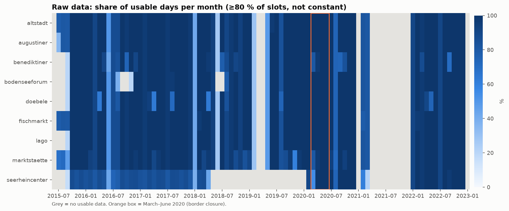
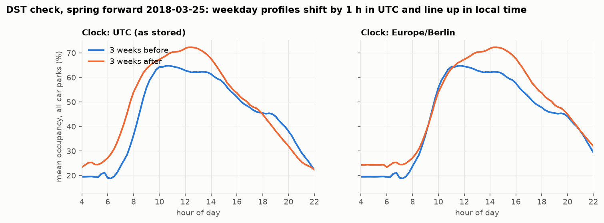
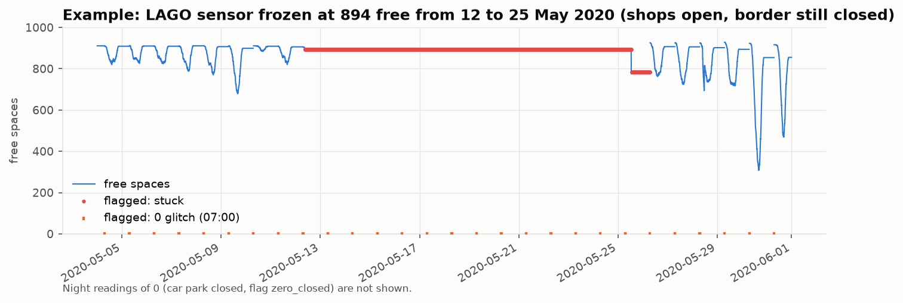
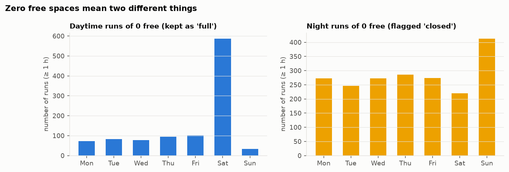
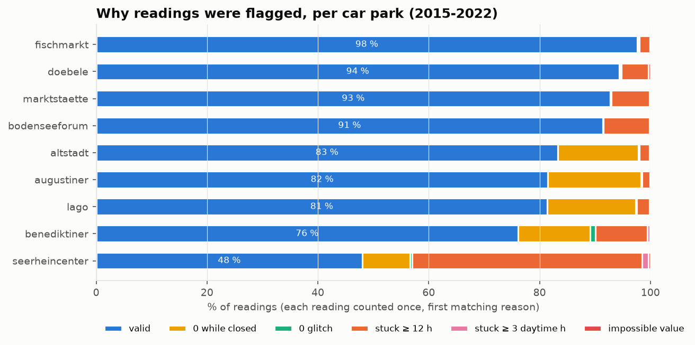
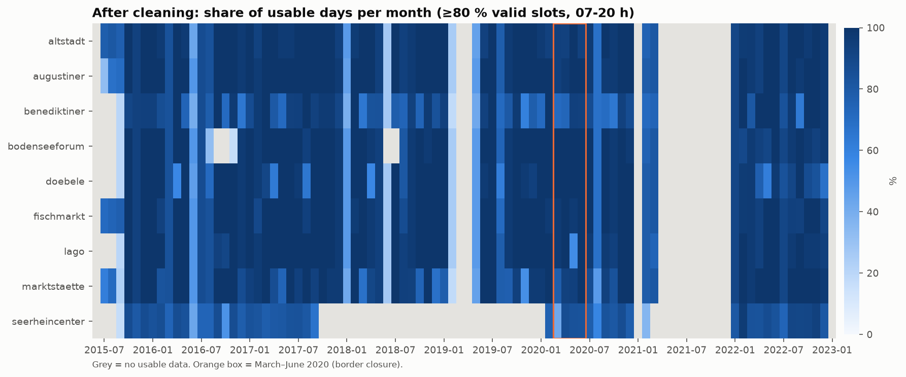

# Data quality report: ParkenDD history for Konstanz (2015-2022)

*Generated by `uv run konstanz-parking report` from the raw dumps. All numbers below are computed,
not typed. Raw files are never modified. Cleaned data: `data/processed/` (not committed: the dumps
carry no license).*

## Summary

- **5 751 148 raw readings** in 78 files for 9 car parks,
  2015-06-30 to 2022-12-31, nominally every 5 minutes (median interval
  5.0 min). Another 411 419 rows from scraper artefacts are excluded.
- After removing superseded backup rows and duplicates, **5 667 572 readings** remain, of which
  **4 704 330 (83.0 %) are valid**. Nothing is deleted silently: every
  reading keeps its flags in `parkendd_clean.parquet`.
- The biggest problems are **frozen values** (sensor or scraper stuck: 11.8 % of readings, some flagged by both rules)
  and **zeros that do not mean "full"**: car parks reporting 0 while closed at night (7.7 %) and a daily 07:00 feed glitch. Zeros during the day are kept, because they mean *full*, mostly on Saturdays.
- **Timestamps are real UTC.** At 12 of 12 DST switches the daily profile shifts in
  UTC in the expected direction (by 0.5-1 h, exactly 1 h at 4); none shows no shift.
- **Official capacities do not match the data.** Some car parks never get near their official
  capacity (possibly because of long-term permit holders), and others regularly report *more* free spaces than they
  officially have. Occupancy is therefore computed against an *effective capacity* derived from
  the data, not the official number.
- **2020 border-closure window:** raw coverage is ≥ 94 % of 5-minute slots for every car park.
  After cleaning, LAGO (the largest car park, at the shopping centre next to the Swiss border) is
  **frozen from 12 to 25 May 2020**, in the middle of the key "shops open, border closed" window.
  Seerheincenter only has live data from February 2020.

## 1. Source and scope

ParkenDD dumps from `https://parkendd.de/dumps/`, format `utc_timestamp,free` without header,
rows unsorted. Downloaded with `konstanz-parking download-parkendd` into the gitignored
`data/external/parkendd/` (no license stated, so never committed).

| car park | dump names | first (UTC) | last (UTC) | ArcGIS max_cap | ParkenDD total | max valid free | effective capacity |
|---|---|---|---|---|---|---|---|
| altstadt | altstadt | 2015-06-30 | 2022-12-31 | 359 | 359 | 271 | 259 |
| augustiner | augustinerkarstadt, augustiner | 2015-07-14 | 2022-12-31 | 288 | – | 282 | 270 |
| benediktiner | benediktiner | 2015-09-23 | 2022-12-31 | 118 | – | 141 | 138 |
| bodenseeforum | amseerhein, bodenseeforum | 2015-09-23 | 2022-12-31 | – | – | 500 | 500 |
| doebele | doebele | 2015-09-23 | 2022-12-31 | 435 | 335 | 335 | 334 |
| fischmarkt | fischmarkt | 2015-06-30 | 2022-12-31 | 161 | 158 | 159 | 158 |
| lago | lago | 2015-09-23 | 2022-12-31 | 931 | 936 | 936 | 936 |
| marktstaette | marktstaette | 2015-06-30 | 2022-12-31 | 288 | – | 262 | 250 |
| seerheincenter | seerheincenter | 2015-09-23 | 2022-12-31 | 312 | 280 | 280 | 280 / 235 |

- *ArcGIS max_cap* and *ParkenDD total* are today's official values (retrieved 2026-11-07).
- *Effective capacity* is the 99.9th percentile of valid free counts (see section 7).
- Two car parks were **renamed by the scraper**, with seamless, non-overlapping series:
  `augustinerkarstadt` → `augustiner` (2022-01-10) and `amseerhein` → `bodenseeforum`
  (2016-11-25). They are merged.
- **Excluded dumps:**

| dump name | rows | reason |
|---|---|---|
| $parkgetbezeichnung | 28 | scraper artefact: unrendered template variable, constant 0 |
| 0 | 104395 | scraper artefact: constant 0, no car park name |
| bykgulden | 6 | renamed bykguldenstr (6 rows, constant 0) |
| bykguldenstr | 301478 | constant 0 from 2016 on; not part of today's parking guidance system |
| xxx | 5512 | scraper artefact: constant 0 ('XXX' is the city's no-data marker) |

## 2. Coverage of the raw data

A day counts as *usable* when ≥ 80 % of its 5-minute slots have a reading and the values are not
all the same. Days are local calendar days, so DST days have 276 or 300 slots instead of 288. Full
table: `tables/coverage_raw_monthly.csv`.

Gaps shared by all car parks are scraper downtime. The largest ones:

| # | start | end | lots | days |
|---|---|---|---|---|
| 1 | 2021-03-26 | 2022-01-03 | 9 | 283.5 |
| 2 | 2019-02-11 | 2019-05-16 | 9 | 94.2 |
| 3 | 2021-01-01 | 2021-02-05 | 9 | 35.8 |
| 4 | 2018-06-01 | 2018-06-22 | 9 | 21.3 |
| 5 | 2016-06-21 | 2016-07-04 | 9 | 13.6 |
| 6 | 2015-07-25 | 2015-08-06 | 4 | 11.6 |
| 7 | 2018-01-12 | 2018-01-20 | 9 | 8.4 |
| 8 | 2018-01-04 | 2018-01-09 | 9 | 5.3 |
| 9 | 2015-09-09 | 2015-09-12 | 4 | 2.7 |
| 10 | 2022-07-05 | 2022-07-07 | 9 | 2.5 |

Two holes matter most: **2019-02-11 to 2019-05-16** and **almost all of 2021** (data only from
2021-02-05 to 2021-03-26; after that the scraper wrote only zeros to the artefact file
`konstanz0`). The four car parks with backup files start in mid-2015; the others on 2015-09-23.

**2020 window, % of 5-minute slots present (raw):**

| lot_id | Jan | Feb | Mar | Apr | May | Jun | Jul | Aug | Sep |
|---|---|---|---|---|---|---|---|---|---|
| altstadt | 99.9 | 100 | 99.9 | 99.3 | 94.3 | 94.7 | 94.1 | 94.3 | 94.6 |
| augustiner | 99.9 | 100 | 99.9 | 99.3 | 94.3 | 94.7 | 94.1 | 94.3 | 94.6 |
| benediktiner | 99.9 | 100 | 99.9 | 99.3 | 94.3 | 94.7 | 94.1 | 94.3 | 94.6 |
| bodenseeforum | 99.9 | 100 | 99.9 | 99.3 | 94.3 | 94.7 | 94.1 | 94.3 | 94.6 |
| doebele | 99.9 | 100 | 99.9 | 99.3 | 94.3 | 94.7 | 94.1 | 94.3 | 94.6 |
| fischmarkt | 99.9 | 100 | 99.9 | 99.3 | 94.3 | 94.7 | 94.1 | 94.3 | 94.6 |
| lago | 99.9 | 100 | 99.9 | 99.3 | 94.3 | 94.7 | 94.1 | 94.3 | 94.6 |
| marktstaette | 99.9 | 100 | 99.9 | 99.3 | 94.3 | 94.7 | 94.1 | 94.3 | 94.6 |
| seerheincenter | 99.9 | 100 | 99.9 | 99.3 | 94.3 | 94.7 | 94.1 | 94.3 | 94.6 |

## 3. Timestamps, time zones and DST

The dumps contain naive timestamps that ParkenDD documents as UTC. Two independent checks confirm
this:

1. **Structure.** On spring-forward nights the series runs through 01:00-03:00 UTC without a gap.
   On fall-back nights there is no doubled hour. Local wall-clock timestamps would show a missing
   or repeated hour.
2. **Behaviour.** People follow local time: shops open at 09:00 local. In true UTC, the weekday
   occupancy profile must move one hour earlier after spring forward and one hour later after
   fall back. The best-aligning lag (15-minute resolution) between the weekday profiles of the
   3 weeks before and after each switch:

| switch | kind | expected_shift_h | observed_shift_h | corr_at_best | corr_at_0 |
|---|---|---|---|---|---|
| 2015-10-25 | fall back | 1 | 0.75 | 0.998 | 0.963 |
| 2016-03-27 | spring forward | -1 | -1 | 0.999 | 0.952 |
| 2016-10-30 | fall back | 1 | 0.75 | 0.994 | 0.954 |
| 2017-03-26 | spring forward | -1 | -1 | 0.995 | 0.95 |
| 2017-10-29 | fall back | 1 | 0.75 | 0.997 | 0.96 |
| 2018-03-25 | spring forward | -1 | -0.75 | 0.988 | 0.957 |
| 2018-10-28 | fall back | 1 | 1 | 0.996 | 0.941 |
| 2019-10-27 | fall back | 1 | 1 | 0.988 | 0.909 |
| 2020-03-29 | spring forward | -1 | -1.75 | 0.979 | 0.757 |
| 2020-10-25 | fall back | 1 | 0.5 | 0.983 | 0.974 |
| 2022-03-27 | spring forward | -1 | -0.75 | 0.996 | 0.968 |
| 2022-10-30 | fall back | 1 | 0.75 | 0.996 | 0.955 |

Every switch shifts in the expected direction and none has its best fit at 0, which is what
mislabelled local time would produce. Shifts below a full hour are probably real behaviour changing
across the switch (e.g. longer evenings, school holidays). The 2020-03-29 switch falls in the first
COVID lockdown, hence its low correlation.

Handling: timestamps are parsed as UTC and stored as `ts_utc`. `ts_local` is derived with
`tz_convert("Europe/Berlin")`. One pitfall came up during development: rounding *local* timestamps
(e.g. `floor("h")`) raises on the ambiguous fall-back hour, so all rounding is done in UTC.

## 4. Duplicates and overlapping files

- **Backup files.** For four car parks, `*.backup-2015.csv` files start earlier (2015-06-30) than
  the main 2015 files (2015-09-23) and overlap them afterwards. The two scrapers sampled a few
  seconds apart, so overlapping rows interleave rather than duplicate. Backup rows are used only
  before the main file starts (83 432 superseded rows dropped). Agreement
  during the overlap (nearest reading within 3 min):

| lot_id | pairs | identical_pct | within_5_pct | mean_abs_diff |
|---|---|---|---|---|
| altstadt | 20716 | 69.2 | 99.1 | 1.11 |
| augustiner | 20716 | 68.1 | 98.4 | 1.26 |
| fischmarkt | 20716 | 72.4 | 99.4 | 0.81 |
| marktstaette | 20716 | 64.5 | 99.2 | 1.03 |

- **Exact duplicates** (same car park, timestamp and value): 135 rows, dropped.
- **Conflicting duplicates** (same timestamp, different value): 9
  rows. The first occurrence in file order is kept and flagged `dup_conflict`.
- No unparseable rows (0).

## 5. Gaps and irregular intervals

Readings come every ~5 minutes with jitter of a few seconds. Gaps between consecutive readings of
one car park: 2 140 longer than 15 min, 510 longer than 1 h and 120
longer than one day (`gap_before`, `gap_before_min`). Gaps are not filled in the long table. On the
15-minute grid, empty bins are interpolated only if the gap is ≤ 30 minutes (flagged
`interpolated`: 1 097 bins). Longer gaps stay missing.

## 6. Frozen values

A run is a sequence of identical consecutive values. Runs are broken at gaps > 60 min, so a data
gap is never mistaken for a frozen sensor. The thresholds were calibrated on the run-length
distribution:

- **`stuck_long`:** the same value for ≥ 12 h. Constant overnight values of 9-12 h are common and
  legitimate (closed or idle car parks). Longer runs are not. Longest examples: Seerheincenter at 0
  from 2018-04 to 2020-02 (sensor dead), Bodenseeforum at 0 for 45 days in summer 2018.
- **`stuck_day`:** the same *non-zero* value for ≥ 3 h of daytime (09-19 local). A busy city car
  park never stays exactly constant for three daytime hours.

Frozen periods that hit **several car parks at the same time** point at the city's feed or the
scraper, not at sensors. Events with ≥ 5 car parks stuck at once (≥ 3 h):

| start | end | hours | max_lots |
|---|---|---|---|
| 2020-08-11 10:00 | 2020-08-20 20:00 | 226 | 9 |
| 2019-08-13 19:00 | 2019-08-20 19:00 | 168 | 9 |
| 2016-08-05 21:00 | 2016-08-09 17:00 | 92 | 9 |
| 2019-02-08 11:00 | 2019-02-11 16:00 | 77 | 9 |
| 2016-03-25 11:00 | 2016-03-28 15:00 | 75 | 9 |
| 2015-11-01 01:00 | 2015-11-02 11:00 | 34 | 9 |
| 2016-12-04 01:00 | 2016-12-05 09:00 | 32 | 9 |
| 2022-04-07 09:00 | 2022-04-08 14:00 | 29 | 7 |
| 2016-03-28 16:00 | 2016-03-29 13:00 | 21 | 9 |
| 2019-07-23 19:00 | 2019-07-24 09:00 | 14 | 9 |
| 2018-04-11 02:00 | 2018-04-11 13:00 | 11 | 5 |
| 2021-02-11 09:00 | 2021-02-11 18:00 | 9 | 9 |

In this example the daily 07:00 zero glitch (section 7) keeps arriving throughout the freeze. So
the city's feed was alive and only LAGO's own counter was stuck, first at 894 and then at 783.

## 7. Zeros, impossible values and capacity

**Zero free spaces mean two different things.** Runs of 0 lasting ≥ 1 h that lie almost entirely
outside 09-19 local time are car parks reporting 0 while *closed* (flag `zero_closed`). This is
most frequent for augustiner, benediktiner, altstadt, lago. Runs of 0 *during* the day are kept as real
*full* events: 56 % of them start on a Saturday, and 58 %
start between 10:00 and 12:59.
That is the Saturday effect this project studies, not a sensor fault.

**Zero glitches.** Several car parks drop to 0 for about 15 minutes **every morning at 07:00
local** (Augustiner, LAGO, Benediktiner), and Döbele, Fischmarkt and Marktstätte do the same at
midnight. They then jump straight back to their previous level (e.g. LAGO 910 → 0 → 909). A car
park cannot fill up and empty again within minutes, so this is a feed reset. Rule `zero_dip`: a
run of zeros (of any length) is invalid when the readings just before *and* just after it are both
above 20 % of effective capacity. Real fill-ups approach 0 gradually and are not affected.
15 141 readings are flagged only by this rule; the others are night closures that
`zero_closed` already catches. This rule was added after the first version of the report, when
the LAGO example plot below showed a spike every morning.

**Negative values** (`negative`, 3 706 readings) occur only in 2022, down to -154 (Bodenseeforum). Invalid.

**Capacity.** The official capacities (ArcGIS `max_cap`, ParkenDD `total`) are today's values and
often contradict the history:

- Benediktiner reports more free spaces than its official 118 in 32 352 readings (up
  to 148). LAGO exceeds its ArcGIS capacity of 931 in 15 659 readings, but stays within
  ParkenDD's 936.
- Altstadt rarely reports more than 259 free (99.9th percentile) of an official 359. Döbele tops out
  at 335, which matches ParkenDD's total, while ArcGIS says 435. Possible
  reasons: spaces reserved for permit holders, or capacity changes after 2022. The sources don't
  say.
- Seerheincenter's ceiling changes from 280 (2015-2017) to 222-235 (from 2020). Capacity periods
  used: seerheincenter at 2019-01-01.

Handling: readings above **1.2 × the larger official capacity** are flagged `implausible_high`
first (e.g. Seerheincenter reporting 1 410 free in June/July 2020), so they cannot distort what
follows. The **effective capacity** is the 99.9th percentile of the remaining valid readings per
car park and capacity period. Readings above 1.05 × effective capacity are also flagged
`implausible_high`. Over-official readings below those limits are kept and flagged
`above_official_capacity` (informational). **Occupancy = 1 − free / effective capacity**, clipped
to [0, 1]. It measures how full the car park is relative to the spaces actually available to
short-term parkers. It is comparable over time within a car park, but not an official utilisation
rate.

**Censoring.** Bodenseeforum never reports more than 500 free (39 493 readings at exactly
500), although it has more spaces on event days. Low occupancy there is right-censored (flag
`censored_high`).

## 8. Result after cleaning

| car park | rows | negative | stuck_long | stuck_day | zero_closed | zero_dip | implausible_high | valid | valid_pct |
|---|---|---|---|---|---|---|---|---|---|
| altstadt | 639327 | 252 | 11810 | 8954 | 93309 | 93629 | 203 | 532351 | 83.3 |
| augustiner | 636135 | 0 | 9046 | 5453 | 106521 | 107480 | 69 | 518560 | 81.5 |
| benediktiner | 622692 | 0 | 58411 | 34614 | 80924 | 85427 | 484 | 473905 | 76.1 |
| bodenseeforum | 622693 | 632 | 52151 | 8923 | 396 | 88 | 0 | 569242 | 91.4 |
| doebele | 622692 | 2087 | 30558 | 8357 | 1506 | 1039 | 0 | 587444 | 94.3 |
| fischmarkt | 639325 | 431 | 12250 | 4528 | 1486 | 1295 | 0 | 624205 | 97.6 |
| lago | 622692 | 304 | 14655 | 12217 | 99193 | 99819 | 0 | 506798 | 81.4 |
| marktstaette | 639324 | 0 | 44353 | 39202 | 298 | 888 | 333 | 592898 | 92.7 |
| seerheincenter | 622692 | 0 | 258413 | 54347 | 53732 | 55755 | 2075 | 298927 | 48 |
| all | 5667572 | 3706 | 491647 | 176595 | 437365 | 445420 | 3164 | 4704330 | 83 |

A reading can carry several flags, so the columns don't add up. `valid` = none of `negative`,
`stuck_long`, `stuck_day`, `zero_closed`, `zero_dip` or `implausible_high`.

**2020 window, % usable days after cleaning** (≥ 80 % valid 5-minute slots between 07 and 20 h
local):

| lot_id | Jan | Feb | Mar | Apr | May | Jun | Jul | Aug | Sep |
|---|---|---|---|---|---|---|---|---|---|
| altstadt | 96.8 | 93.1 | 93.5 | 93.3 | 100 | 93.3 | 96.8 | 67.7 | 100 |
| augustiner | 100 | 100 | 93.5 | 96.7 | 100 | 100 | 96.8 | 67.7 | 96.7 |
| benediktiner | 71 | 100 | 71 | 73.3 | 93.5 | 93.3 | 87.1 | 67.7 | 70 |
| bodenseeforum | 100 | 100 | 100 | 100 | 100 | 100 | 100 | 67.7 | 100 |
| doebele | 100 | 100 | 100 | 100 | 100 | 100 | 100 | 67.7 | 100 |
| fischmarkt | 100 | 96.6 | 96.8 | 100 | 96.8 | 100 | 100 | 67.7 | 100 |
| lago | 100 | 100 | 96.8 | 100 | 54.8 | 100 | 96.8 | 67.7 | 96.7 |
| marktstaette | 96.8 | 100 | 77.4 | 93.3 | 93.5 | 100 | 87.1 | 48.4 | 93.3 |
| seerheincenter | 0 | 75.9 | 41.9 | 86.7 | 83.9 | 83.3 | 77.4 | 58.1 | 83.3 |

Notes on the 2020 natural experiment:

- LAGO, the largest car park and the one right at the Swiss border, is frozen from 12 to 25 May 2020
  (97 % of its readings in that span are flagged). Those two weeks fall in
  the key "shops open in BW, border closed" phase, which therefore rests on the other car parks
  for that fortnight.
- Seerheincenter only becomes usable in February 2020, so it has almost no pre-COVID baseline.
- August 2020 has a feed-wide freeze (11-20 August, all car parks).
- The university car parks (the planned control group) are not in the ParkenDD history at all. They
  exist only in the live data collected since November 2026.

**15-minute grid:** 2 326 177 lot × 15-minute bins between each car park's first and last
reading, 68.4 % of them non-missing. The missing bins are mostly the two big holes
(2019 and 2021) and nights at car parks that close.

## 9. Outputs

| file | content |
|---|---|
| `data/processed/parkendd_clean.parquet` | every reading with `ts_utc`, `ts_local`, `free`, `occupancy`, `valid` and all flags |
| `data/processed/parkendd_15min.parquet` | regular UTC grid per car park: mean free of valid readings, `n_readings`, `interpolated`, `occupancy` |
| `reports/tables/*.csv` | coverage per month (raw and after cleaning), flags per lot, DST check, freezes, gaps |

## 10. Limitations and open questions

- The thresholds (12 h, 3 daytime h, 1 h of zeros outside 09-19 h) are judgement calls calibrated
  on this data. They are constants at the top of `history/clean.py`, and the report regenerates if
  they change.
- Effective capacities are derived from the data. If a car park was never close to empty during the
  history, its occupancy is overstated in absolute terms. Within-car-park comparisons are
  unaffected.
- A sensor stuck at 0 for less than 12 h during the day cannot be told apart from a car park that is
  really full. Such readings are kept.
- Night-time occupancy is mostly unavailable for car parks that close at night. The analysis
  should focus on opening hours.
- Marktstätte's highest free count drifts with the season (≈ 200 in summer, ≈ 240 in winter). This
  probably reflects varying numbers of long-term parkers. It is not modelled as a capacity change.
- The ParkenDD scraper mirrors the city's guidance-system page. Errors in the city's own feed (e.g.
  the August 2020 freeze) cannot be told apart from scraper errors.
